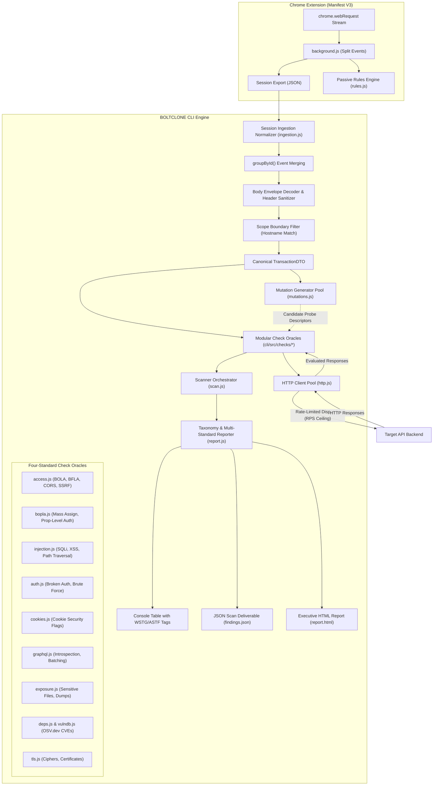

# Design Document: Unified OWASP Testing Engine (Web Top 10, API Top 10, WSTG & ASTF)

* **Author:** kiyaTolcha
* **Date:** 2026-11-03
* **Status:** Implemented & Verified (Phases 1–4 Complete)

---

## 1. Problem Statement & Overview

### 1.1 The Problem
Security engineers, developers, and QA teams evaluating modern web applications and API architectures must navigate four foundational, intersecting security standards:
1. **OWASP Top 10 Web Application Security Risks (2021)**: Broad application-level security risk categories.
2. **OWASP API Security Top 10 (2023)**: Dedicated API business logic, object-level access (Broken Object Level Authorization / BOLA), Broken Function Level Authorization (BFLA), Broken Object Property Level Authorization (BOPLA), and resource consumption risks.
3. **OWASP Web Security Testing Guide (WSTG v4.2)**: Comprehensive, procedural testing methodologies for web applications (Information Gathering, Configuration, Identity, Authentication, Authorization, Session Management, Input Validation, Error Handling, Cryptography, Business Logic, and Client-Side testing).
4. **OWASP API Security Testing Framework (ASTF)**: Systematic methodology specifically targeting API reconnaissance, authentication mechanics, property-level validation, rate limiting, and shadow/zombie API identification.

Currently, tooling across these four standards is highly fragmented:
* **Authentication and State Blindness**: Traditional crawlers and fuzzers test unauthenticated public routes, failing to reach authenticated workflows where WSTG authorization (WSTG-ATHZ) and ASTF object-level tests (ASTF-ATHZ / Insecure Direct Object Reference [IDOR] / BOLA) reside. BOLTCLONE's Chrome extension captures authenticated browser sessions, but the CLI previously stripped all headers, cookies, tokens, and payloads, preventing authenticated procedural testing.
* **Lack of Procedural Test Rigor**: Without alignment to WSTG and ASTF methodologies, vulnerability scans rely on ad-hoc URL checks rather than systematic procedural verification (e.g., comparing baseline vs cross-tenant responses, testing parameter boundaries, auditing cookie security flags, or verifying cryptographic ciphers).
* **Toolchain Sprawl**: Teams operate multiple separate tools (Burp Suite Pro, OWASP ZAP, Postman, custom scripts) across standards, hindering automated integration into CI/CD pipelines.
* **Destructive Testing Risks**: Automated fuzzers that mutate state-altering verbs (`POST`, `PUT`, `DELETE`) without semantic context risk corrupting live or staging databases, deleting records, or locking test accounts without guardrails.

### 1.2 Overview
This design establishes an end-to-end, zero-dependency testing architecture in BOLTCLONE that directly operationalizes:
- **OWASP Top 10 Web (2021)** (A01–A10)
- **OWASP API Security Top 10 (2023)** (API1–API10)
- **OWASP Web Security Testing Guide (WSTG)** procedural test workflows
- **OWASP API Security Testing Framework (ASTF)** systematic API verification

The unified architecture provides:
1. **Stateful Ingestion & Normalization**: Porting transaction merging (`groupById`) to the CLI to recombine split browser `webRequest` events, decode body envelopes (`raw.text`, `formData`), sanitize transport headers, and enforce strict target host scope.
2. **Dual-Context Authorization Matrix**: Providing `--secondary-auth <token|cookie>` to execute comparative cross-tenant tests, systematically evaluating WSTG-ATHZ-02 (IDOR) and ASTF-ATHZ-01 (BOLA) while significantly minimizing false positives compared to single-token checks.
3. **Procedural Multi-Standard Check Suite**: Coordinating passive in-browser analysis (`chrome-extension/rules.js`) with active CLI modules (`cli/src/checks/*` and `cli/src/mutations.js`), annotating every finding with its exact OWASP Top 10, WSTG, and ASTF identifiers.
4. **Safe-by-Default Execution**: Restricting automated mutation sweeps to read-only/idempotent methods (`GET`, `HEAD`, `OPTIONS`) by default, requiring explicit opt-in (`--allow-mutating-methods`) for state-altering verbs.
5. **Zero External Runtime Dependencies**: Standard Node.js 20+ runtime only (`node:util`, `node:crypto`, `node:tls`, `node:fs`, native `fetch`).

### 1.3 Goals & Non-Goals

#### Goals
* **G-1 (Four-Standard Security Alignment)**: Implement active and passive detection mechanisms mapped across:
  - OWASP Web Top 10 (2021) Categories A01–A10
  - OWASP API Security Top 10 (2023) Categories API1–API10
  - OWASP WSTG Categories (INFO, CONF, IDNT, ATHN, ATHZ, SESS, INPV, ERRH, CRYP, BUSL, CLNT)
  - OWASP ASTF Workflows (DISC, AUTH, ATHZ, INPT, BUSL, CONF)
* **G-2 (Dual-Context Authorization Engine)**: Support comparative multi-tenant evaluation (`--secondary-auth`) to verify resource isolation across Owner, Foreign User, and Unauthenticated contexts (WSTG-ATHZ-02, ASTF-ATHZ-01).
* **G-3 (Canonical Session Ingestion)**: Ingest heterogeneous Chrome extension export formats, merge split request lifecycle events, and unpack JSON and form payloads into mutable structures.
* **G-4 (Target Scope Boundary Enforcement)**: Enforce strict hostname scope matching on all replayed traffic to prevent cross-origin credential exfiltration.
* **G-5 (Safe-by-Default Replay)**: Restrict automated parameter mutation to idempotent HTTP methods by default; gate write-verb mutations behind `--allow-mutating-methods`.
* **G-6 (Unified Compliance Reporting)**: Generate console summaries, JSON deliverables, and executive HTML reports where each vulnerability is mapped to its corresponding Top 10, WSTG, and ASTF taxonomy tags.
* **G-7 (Synthetic Traffic Classification)**: Inject standard distributed tracing headers (`X-Bolt-Test-Run`, `X-Synthetic-Test: true`) so backend APMs isolate scanner traffic from production metrics.
* **G-8 (Zero Runtime Dependencies)**: Keep the entire CLI scanner built strictly on Node.js built-in modules.

#### Non-Goals
* **NG-1 (Automated Destructive Write Fuzzing by Default)**: No automated deletion or modification of backend state without explicit operator consent.
* **NG-2 (Headless Browser Driver Integration)**: Will not embed Chromium or Puppeteer into the CLI; web browsing traffic capture remains the domain of the Chrome extension.
* **NG-3 (Complex Binary Protocol Fuzzing)**: Arbitrary binary and proprietary protocol fuzzing is out of scope and remains delegated to dedicated DAST platforms via `--openapi` and `--postman` exports.

---

## 2. Technical Plan

### 2.1 Architectural Overview & Data Flow
The upgraded architecture bridges captured browser interactions into an automated multi-standard security scanner.



### 2.2 Four-Standard Procedural Mapping Matrix
The scanner organizes all detection modules across OWASP Web 2021, OWASP API 2023, WSTG v4.2, and ASTF:

| Category / Area | OWASP Web (2021) | OWASP API (2023) | WSTG v4.2 Identifier | ASTF Workflow | Check Implementation |
| :--- | :--- | :--- | :--- | :--- | :--- |
| **Object Authorization** | A01: Broken Access | API1: BOLA | `WSTG-ATHZ-02` | `ASTF-ATHZ-01` | `checks/access.js` & `mutations.js` |
| **Function Authorization** | A01: Broken Access | API5: BFLA | `WSTG-ATHZ-03` | `ASTF-ATHZ-02` | `checks/access.js` (Role swapping) |
| **Property Authorization** | A01: Broken Access | API3: BOPLA | `WSTG-BUSL-07` | `ASTF-ATHZ-03` | `checks/bopla.js` (Mass assignment & PII) |
| **Authentication Testing** | A07: Identification | API2: Broken Auth | `WSTG-ATHN-01..08` | `ASTF-AUTH-01..04` | `checks/auth.js` (Default creds & token validation) |
| **Session Management** | A07: Identification | API2: Broken Auth | `WSTG-SESS-01..09` | `ASTF-AUTH-05` | `checks/cookies.js` (`Secure`, `HttpOnly`, `SameSite`) |
| **Resource Consumption** | A04: Insecure Design | API4: Resource Abuse | `WSTG-BUSL-05` | `ASTF-BUSL-01` | `checks/access.js` (Rate limit) & `checks/graphql.js` |
| **Injection (SQL, XSS, etc)**| A03: Injection | API8: Misconfig | `WSTG-INPV-01..19` | `ASTF-INPT-01..05` | `checks/injection.js` (SQLi, XSS, Traversal, SSTI, XXE) |
| **SSRF** | A10: SSRF | API7: SSRF | `WSTG-INPV-19` | `ASTF-INPT-06` | `checks/access.js` (Metadata/Loopback reflection) |
| **Security Misconfiguration**| A05: Misconfiguration | API8: Misconfig | `WSTG-CONF-01..11` | `ASTF-CONF-01..03` | `checks/access.js` (CORS, HSTS, CSP, Host Header) |
| **Cryptographic Failures** | A02: Crypto Failures | API8: Misconfig | `WSTG-CRYP-01..04` | `ASTF-CONF-04` | `checks/tls.js` (Certs, protocols, weak ciphers) |
| **Vulnerable Dependencies** | A06: Outdated Comps | API8: Misconfig | `WSTG-CONF-05` | `ASTF-CONF-05` | `checks/deps.js` & `vulndb.js` (OSV.dev query) |
| **Information Disclosure** | A05: Misconfiguration | API8: Misconfig | `WSTG-INFO-01..10` | `ASTF-DISC-01..04` | `checks/exposure.js` & `discovery.js` |
| **Inventory / Stale APIs** | A05: Misconfiguration | API9: Inventory Mgmt | `WSTG-CONF-06` | `ASTF-DISC-05` | `checks/access.js` (Legacy API routes) & `openapi.js` |

### 2.3 Subsystem Breakdown & Module Design

#### 2.3.1 Ingestion & Event Normalizer (`cli/src/ingestion.js`)
* **Transaction Contract (`TransactionDTO`)**:
  ```typescript
  interface TransactionDTO {
    id: string;                              // Shared webRequest ID across split events
    url: string;                             // Canonical target URL
    method: string;                          // Normalized uppercase HTTP verb (GET, POST, etc.)
    headers: Record<string, string>;         // Lowercased, sanitized request headers
    body: object | string | null;            // Decoded payload (parsed JSON, form map, or raw string)
    bodyFormat: 'json' | 'form' | 'raw' | 'empty'; // Payload serialization format
    statusCode: number | null;               // Recorded HTTP response status
    responseHeaders: Record<string, string>; // Lowercased response headers
    responseBody: any | null;                // Response payload if captured or fetched
    isEnriched: boolean;                     // True if headers/payloads captured; false for URL-only
  }
  ```
* **Event Merging**: Recombines split `chrome.webRequest` events (`onBeforeRequest`, `onSendHeaders`, `onHeadersReceived`) sharing a common `id` into unified `TransactionDTO` records.
* **Header Sanitization**: Converts array-based headers (`[ { name, value } ]`) into a lower-cased dictionary. Strips browser transport pseudo-headers (`sec-ch-ua*`, `host`, `content-length`, `connection`, `upgrade-insecure-requests`).
* **Body Envelope Unpacking**: Automatically extracts payload data from Chrome extension wrappers:
  - Form data: `{ formData: { key: ["val"] } }` -> Normalized key-value map.
  - Raw JSON: `{ raw: [ { text: "..." } ] }` -> Decoded JSON object with syntax validation.
* **Scope Boundary Enforcement**: Filters all transactions to ensure `new URL(tx.url).hostname === new URL(baseUrl).hostname` (with wildcard subdomain support when specified). Drops off-target requests to prevent credential exfiltration.

#### 2.3.2 Mutation & Tampering Engine (`cli/src/mutations.js`)
* **Decoupled Architecture**: Isolated from transport (`http.js`) and assertions (`access.js`), functioning as candidate mutation generators:
  - `generateIdorMutations(tx)`: Detects numeric IDs, UUIDs, and slug paths, yielding candidate adjacent ID probes.
  - `generateBflaMutations(tx, secondaryToken)`: Tests role boundary escalation by swapping User A auth tokens with User B tokens, or stripping authorization entirely.
  - `generateParamMutations(tx, payloads)`: Injects fuzz vectors across query parameters and JSON body keys without corrupting overall JSON syntax.
* **Safety Invariant**: Filters candidate generation by HTTP method: `GET`, `HEAD`, and `OPTIONS` execute in safe mode. Non-idempotent methods (`POST`, `PUT`, `PATCH`, `DELETE`) are skipped unless `--allow-mutating-methods` is enabled.

#### 2.3.3 Dual-Context Authorization Oracle (`cli/src/checks/access.js`)
* **Differential Access Matrix**:
  1. **Baseline Request**: Executes request with Owner credentials (`User A`). Expected: HTTP 200 with resource body.
  2. **Tampered Unauth Request**: Executes tampered request with no credentials. Expected: HTTP 401 or 403. If 200 returned on non-public route, flags potential unauthenticated access.
  3. **Tampered Cross-Tenant Request**: Executes tampered request with `--secondary-auth` (`User B` Bearer token or Cookie string). Expected: HTTP 403 or 404.
* **Finding Classification**: If Probe 2 confirmed the route requires authentication (HTTP 401/403) and Probe 3 returns HTTP 200 with matching schema structure (>= 50% key overlap), flags a high-confidence **BOLA (OWASP API1 / WSTG-ATHZ-02 / ASTF-ATHZ-01)** finding.

#### 2.3.4 Transport & Synthetic Telemetry (`cli/src/http.js`)
* **Token-Bucket Rate Limiter**: Configurable dispatch ceiling (default: 15 RPS, minimum: 1 via `--rate-limit <rps>`, max sockets: 8) to protect target infrastructure and avoid WAF bans.
* **Synthetic Traffic Tagging**: Outgoing test probes carry headers:
  - `X-Bolt-Test-Run: <UUID>`
  - `X-Synthetic-Test: true`
  - `X-Bolt-Standard: <WSTG|ASTF|OWASP-API|OWASP-WEB>`
  - `User-Agent: BOLTCLONE-SecurityScanner/<version>`
* **Response Decompression**: Handles transparent stream and buffer decompression before passing response bodies to assertion oracles.
* **Redirect Isolation**: Sets `redirect: 'manual'` to prevent automated transmission of authorization headers across cross-host 3xx redirects.

#### 2.3.5 Multi-Standard Compliance Reporting (`cli/src/report.js` & `htmlReport.js`)
* **Finding Data Structure**:
  ```typescript
  interface FindingDTO {
    category: string;
    title: string;
    severity: 'high' | 'medium' | 'low' | 'info';
    url: string;
    evidence: string;
    standards: {
      owaspWeb?: string;   // e.g. "A01:2021-Broken Access Control"
      owaspApi?: string;   // e.g. "API1:2023-BOLA"
      wstg?: string | null;// e.g. "WSTG-ATHZ-02"
      astf?: string | null;// e.g. "ASTF-ATHZ-01"
    };
  }
  ```
* **Output Deliverables**: Console table grouped by standard, structured JSON export (`--json`), CSV export (`--csv`), and standalone interactive HTML report (`--html`) featuring severity filters and compliance checklists. Sensitive credentials and PII in `evidence` are redacted before output.

---

## 3. Risks, Limitations & Mitigations

| Risk | Impact | Mitigation Strategy |
| :--- | :--- | :--- |
| **WAF / Rate-Limiting Trip** | Automated scanner traffic triggers 429/403 blocks or IP bans. | Built-in token-bucket rate limiter (`createRateLimiter`, default: 15 RPS, configurable via `--rate-limit <rps>`). |
| **Large Session Files (Heap Usage)** | Large Chrome extension session dumps (100MB+) consume Node heap. | Strict target hostname scope matching filters off-origin entries early during ingestion; payload unpacking discards binary media types. File size ceilings can be enforced via `fs.statSync`. |
| **Secondary Token Expiration Mid-Scan** | Expired User B token causes dual-context BOLA/BFLA oracles to misclassify legitimate 401s as passes. | Scanner runs pre-flight baseline connectivity and authentication probes for both primary captured tokens and `--secondary-auth` before initiating active oracles; warns operator on 401/403. |
| **Target State Pollution / Data Corruption** | Mutating requests (`POST`, `PUT`, `DELETE`) alter live databases. | Safe-by-default execution invariant: parameter mutations are restricted to idempotent verbs (`GET`, `HEAD`, `OPTIONS`). Mutating verbs require explicit `--allow-mutating-methods` opt-in and support `--dry-run` inspection. |
| **Cross-Domain Credential Exfiltration** | Follow-redirect behavior forwards Authorization headers to off-target hosts. | Strict hostname scope filtering in `ingestion.js` drops foreign URLs; `timeoutFetch` sets `redirect: 'manual'` to prevent forwarding sensitive credentials across 3xx redirects. |
| **PII / Secret Exposure in Deliverables** | Sensitive data (passwords, tokens, SSNs) printed to scan reports. | Reporter performs mandatory masking in `FindingDTO.evidence` (redacting auth headers, truncating keys, masking SSNs). |

---

## 4. Alternatives Considered

* **Monolithic Check Overload (Embedding Mutation in `access.js` & `http.js`)**:
  * *Description*: Directly adding JSON body parsing, path AST traversal, and parameter mutation loops into existing `cli/src/checks/access.js` and `cli/src/http.js` modules.
  * *Decision & Trade-offs*: Violates the Single Responsibility Principle. Coupling network transport with testing state machines alters established `(url, timeout, [opts])` function signatures and complicates heuristic maintenance.
* **Single-Session ID Incrementation (`ID + 1`) for BOLA**:
  * *Description*: Retaining the legacy approach of testing IDOR by naively incrementing numeric path segments under a single user token.
  * *Decision & Trade-offs*: Insufficient for authenticated OWASP API1 / WSTG-ATHZ-02 verification because it cannot differentiate between public endpoints, data owned by the same user, and actual unauthorized cross-tenant leaks. Retained as an unauthenticated fallback heuristic on plain URLs, but deprecated for authenticated authorization testing where dual-context verification is required.
* **External DAST / Fuzzing Dependencies (Axios, Lodash, Schemathesis)**:
  * *Description*: Importing third-party npm packages to handle HTTP requests, deep cloning, and OpenAPI fuzzing.
  * *Decision & Trade-offs*: Violates BOLTCLONE's core architectural principle of zero external runtime dependencies. Node.js 20+ standard library (`fetch`, `crypto`, `util`, `tls`, `fs`) provides all required primitives with lower supply-chain attack surface and minimal startup overhead.
* **Confining Active Testing Strictly to Browser UI (Manipulator Wizard)**:
  * *Description*: Relying exclusively on the Chrome extension's interactive DevTools panel for all active mutation and IDOR tests.
  * *Decision & Trade-offs*: Prevents headless automation, scheduled security testing, and integration into CI/CD regression pipelines.
* **Bundling Chromium / Puppeteer in the CLI Scanner**:
  * *Description*: Embedding headless browser drivers in the CLI to crawl authenticated Single-Page Applications (SPAs) directly.
  * *Decision & Trade-offs*: Adds over 300MB of binary dependencies, creates platform-specific installation friction, and duplicates the Chrome extension's native role as the browser traffic collector.

---

## 5. Detailed Implementation Plan

The implementation is partitioned into four phases; each phase leaves the codebase buildable and testable.

```
Phase 1: Ingestion Normalizer & Transport Hardening
    │
    ▼
Phase 2: Mutation Engine & Dual-Context Authorization Oracle
    │
    ▼
Phase 3: BOPLA Mass Assignment & Multi-Standard Check Expansion
    │
    ▼
Phase 4: Multi-Standard Taxonomy Reporting & Test Harness
```

### 5.1 Target File Boundary & Scope

| Action | Repository-Relative Path | Rationale |
| :--- | :--- | :--- |
| **Create** | `cli/src/ingestion.js` | Merges split `chrome.webRequest` events, decodes body envelopes, sanitizes transport headers, and enforces target host boundaries. |
| **Create** | `cli/src/mutations.js` | Implements generator pipeline for IDOR, BFLA, and parameter fuzzing candidate mutations. |
| **Create** | `cli/src/checks/bopla.js` | Evaluates property-level authorization and mass assignment vulnerabilities (API3 / WSTG-BUSL-07 / ASTF-ATHZ-03). |
| **Modify** | `cli/bin/boltclone.js` | Forwards `--secondary-auth`, `--allow-mutating-methods`, `--dry-run`, and `--rate-limit` from CLI arguments into `runScan()`. |
| **Modify** | `cli/src/args.js` | Adds `--secondary-auth`, `--allow-mutating-methods`, `--dry-run`, and `--rate-limit` CLI arguments with help documentation. |
| **Modify** | `cli/src/http.js` | Implements token-bucket rate limiting (default 15 RPS via `createRateLimiter` and `setDefaultRateLimit`), synthetic telemetry headers (`X-Bolt-Test-Run`), and manual redirect isolation. |
| **Modify** | `cli/src/checks/access.js` | Integrates dual-context BOLA verification with `--secondary-auth`, adds BFLA role tampering check, and supports polymorphic transaction descriptors. |
| **Modify** | `cli/src/scan.js` | Connects `ingestion.js` and `mutations.js`, executes pre-flight auth and secondary auth validation, orchestrates check pools, and implements `--dry-run` mutation preview. |
| **Modify** | `cli/src/report.js` | Adds four-standard taxonomy tags (console two-line format, JSON `findings[].standards`, CSV columns `owaspWeb,owaspApi,wstg,astf`) to all report outputs; see § 2.3. |
| **Modify** | `cli/src/htmlReport.js` | Adds `stdCounts`, `standardsBadges()`, `standardsDataAttrs()`, `filterStd()` helpers and 5 interactive taxonomy filter buttons to the HTML report; see § 2.3. |
| **Create** | `cli/test/test-owasp-engine.js` | Automated verification test suite (22 suites) covering session ingestion, dual-context BOLA detection, BOPLA checks, rate limiting, and scope filtering. |
| **Modify** | `cli/README.md` | Documents new flags, multi-standard testing workflows, and dual-context usage examples. |
| **Modify** | `cli/bin/README.md` | Updates binary entry-point contract to reflect new forwarded flags and exit codes. |
| **Modify** | `cli/src/README.md` | Updates package contract to reflect `ingestion.js`, `mutations.js`, and `bopla.js` with corrected line anchors. |
| **Modify** | `cli/src/checks/README.md` | Updates check subsystem contract to document `bopla.js`, dual-context signatures, and correct line anchors. |

---

### 5.2 Phase 1: Ingestion Normalizer & Transport Hardening

#### Step 1.1: Create Session Ingestion Normalizer (`cli/src/ingestion.js`)
* **Functions to Implement**:
  - `groupById(logEntries)`: Ingests an array of raw Chrome webRequest event logs. Groups entries by `entry.id`, merging properties across `onBeforeRequest` (URL, method, requestBody), `onSendHeaders` (requestHeaders), and `onHeadersReceived` (statusCode, responseHeaders).
  - `decodeRequestBody(requestBody, contentType)`: Unpacks `{ raw: [{ text }] }` multi-chunk concatenation; sniffs `application/+json` MIME type; falls back on `SyntaxError`; flattens `{ formData: { key: [val] } }` into standard maps. Returns `{ decoded: object|string|null, format: 'json'|'form'|'raw'|'empty' }`.
  - `sanitizeHeaders(headersArray)`: Converts `[{ name, value }]` to a lower-cased `Record<string, string>`. Drops an explicit 24-entry `NOISE_HEADERS` Set: `host`, `content-length`, `connection`, `transfer-encoding`, `upgrade-insecure-requests`, `sec-ch-ua`, `sec-ch-ua-mobile`, `sec-ch-ua-platform`, `sec-ch-ua-arch`, `sec-ch-ua-bitness`, `sec-ch-ua-full-version`, `sec-ch-ua-full-version-list`, `sec-ch-ua-model`, `sec-ch-ua-wow64`, `sec-fetch-dest`, `sec-fetch-mode`, `sec-fetch-site`, `sec-fetch-user`, `dnt`, `pragma`, `cache-control`, `te`, `accept-encoding`, `accept-language`. Applied to both `requestHeaders` and `responseHeaders`.
  - `normalizeSession(rawSessionData, targetBaseUrl)`: Sniffs root envelope from four supported shapes: `{ boltcloneTraffic: [...] }`, `{ analysis: [...] }`, `{ meta: { importedTraffic: [...] } }`, or raw `Array`. Runs `groupById`, filters transactions by `new URL(tx.url).hostname === new URL(targetBaseUrl).hostname`, decodes bodies, sanitizes headers, and returns canonical `TransactionDTO[]` (9 fields: `id`, `url`, `method`, `headers`, `body`, `statusCode`, `responseHeaders`, `isEnriched`, `targetHost`). ID fallback: `anon-${i}` for entries without a usable id. Hostname filter: on `URL` parse failure `targetHost = null` (fail-open — transaction is **kept** if `targetHost` cannot be determined).
* **Degraded-Enrichment Fallback**: If an imported file contains only `analysis` objects without headers/body, `normalizeSession` extracts only URLs and returns transactions with `isEnriched: false`.

#### Step 1.2: Harden HTTP Transport & Rate Limiting (`cli/src/http.js`)
* **Functions to Implement / Modify**:
  - `createRateLimiter(rps = 15)`: Implements a **fixed-interval (`Math.floor(1000 / rps)` ms) FIFO pacing queue** — `throttle()` resolves when the slot is free. Returns `{ throttle: async () => void, backoff: (retryAfterSeconds = 2) => void }`. `.backoff()` inserts a mandatory delay clamped to 1 s–30 s (default 2 s), used by `safeFetch` on HTTP 429.
  - `setDefaultRateLimit(rps)`: Configures global rate limiter ceiling for the scanner. Called during `runScan()` startup.
  - `getSessionRunId()`: Returns the unique session UUID v4 (created once per process via `node:crypto.randomUUID()`) used for APM telemetry isolation.
  - `safeFetch(url, opts, timeoutMs)`: Non-throwing wrapper around `timeoutFetch`; returns `null` on any error.
  - `pool(items, limit, worker)`: Bounded-concurrency promise pool runner.
  - Update `timeoutFetch(url, opts, timeoutMs)`:
    - Calls `await throttle()` **before** the `AbortController` timer starts to avoid charging timeout against queue wait.
    - `timeoutFetch` sets `redirect: 'manual'` to prevent automated transmission of credentials across off-target 3xx redirects.
    - Injects synthetic identification headers on every request:
      - `X-Bolt-Test-Run`: Active session UUID from `getSessionRunId()`.
      - `X-Synthetic-Test: true`
      - `X-Bolt-Standard`: Standard identifier tag passed in `opts.standard`.
      - `User-Agent: BOLTCLONE-SecurityScanner/1.0.0`
    - Transparent decompression via `decompressResponse`: buffers `arrayBuffer()` for `content-encoding: gzip` (`zlib.gunzipSync`), `br` (`zlib.brotliDecompressSync`), and `deflate` (`zlib.inflateSync`); strips `content-encoding` and `content-length` response headers; returns raw bytes on decompression error (no silent discard).
* **Verification Checkpoint**: Run `node cli/bin/boltclone.js --help` to confirm the process starts without error.

---

### 5.3 Phase 2: Mutation Engine & Dual-Context Authorization Oracle

#### Step 2.1: Create Mutation & Tampering Engine (`cli/src/mutations.js`)
* **Functions to Implement**:
  - `*generateIdorMutations(tx, allowMutating = false)`: Analyzes `tx.url`. If method is not `GET`/`HEAD`/`OPTIONS` and `allowMutating` is false, returns immediately. Skips entries where the numeric ID segment `n < 0`. Detects integer path segments (tests `ID + 1`, `ID - 1`), UUID v4 segments (increments the final 12-hex-digit group by `1n mod 0xffffffffffffn`), and query parameter IDs (21-entry `ID_PARAM_KEYS`: `id`, `user_id`, `account_id`, `customer_id`, `order_id`, `item_id`, `resource_id`, `object_id`, `record_id`, `entity_id`, `profile_id`, `post_id`, `comment_id`, `ticket_id`, `invoice_id`, `payment_id`, `session_id`, `token_id`, `file_id`, `doc_id`, `ref`). Yields candidate mutation objects `{ tx, mutatedUrl, mutatedBody, mutatedHeaders, mutationType: 'IDOR', mutationDetail }`.
  - `*generateBflaMutations(tx, secondaryAuthToken, allowMutating = false)`: Only targets URLs matching 11 `PRIVILEGED_PATH_PATTERNS` regexes: `/admin`, `/manage`, `/superuser`, `/root`, `/internal`, `/staff`, `/privileged`, `/system`, `/backoffice`, `/console`, `/superadmin` (each as case-insensitive path-segment match). `allowMutating` gates `POST`/`PUT`/`PATCH` on this generator too. Yields two mutations:
    1. `BFLA_UNAUTH`: strips `Authorization` and `Cookie` headers. Auth prefix: `Bearer ` is auto-prepended when `secondaryAuthToken` does not already contain `:` or `=`.
    2. `BFLA_CROSSTENANT`: replaces `Authorization` with `Bearer <secondaryAuthToken>` (cookie headers are **not** parsed for BFLA mutations).
    Each yielded object includes `mutationDetail`.
  - `*generateParamMutations(tx, payloads, allowMutating = false)`: Injects 15 `DEFAULT_FUZZ_PAYLOADS` (4 SQLi: `' OR '1'='1`, `'; DROP TABLE users;--`, `1 OR 1=1`, `' UNION SELECT NULL--`; 2 XSS: `<script>alert(1)</script>`, `">`; 2 path traversal: `../../../etc/passwd`, `..%2F..%2Fetc%2Fpasswd`; 2 SSTI: `{{7*7}}`, `${7*7}`; 5 null/boundary: `null`, `undefined`, `0`, `-1`, `99999999`) across query strings and JSON object keys. `injectIntoJsonBody` only injects into top-level `string|number` scalar values (not nested objects or arrays). Yields `{ tx, mutatedUrl, mutatedBody, mutatedHeaders, mutationType: 'PARAM_FUZZ', mutationDetail }`.
* **Consumer note**: `mutations.js` generators are consumed by `printDryRun()` for aggregate mutation counts. Active scan checks (`access.js`, `bopla.js`) build their own probes independently and do **not** iterate these generators.

#### Step 2.2: Implement Dual-Context Oracle in `cli/src/checks/access.js`
* **Functions to Modify**:
  - Update `checkIdorBola(target, timeout, options = {})`:
    - **Trigger**: fires when `tx.isEnriched && tx.headers?.authorization` (presence of auth header on an enriched transaction; does **not** require `options.secondaryAuth` to be set).
    - Handles polymorphic `target`: string URL or `TransactionDTO`.
    - If `TransactionDTO` has auth headers and `options.secondaryAuth` is set:
      1. **Probe 1** — baseline request with original credentials (asserts 2xx, i.e. HTTP 200–299).
      2. **Probe 2** — unauthenticated probe with stripped credentials. If 2xx returned: flags `'Potential unauthenticated access (BOLA/IDOR)'` at `medium` severity, standard `BOLA`. Probe 3 runs regardless of Probe 2 outcome.
      3. **Probe 3** — cross-tenant probe with `options.secondaryAuth`. Resolves auth format: `Cookie:` prefix → cookie header; value contains `=` without `Bearer ` prefix → cookie header; otherwise → `Bearer <token>`. If 2xx returned and JSON schema similarity (`shared / Math.max(keysA.size, keysB.length) >= 0.5`), flags `'Confirmed BOLA — cross-tenant object access'` at `high` severity, standards `ASTF-ATHZ-01`.
    - If `target` is a plain string URL, falls back to legacy path-increment check.
  - Implement `checkBfla(tx, timeout, secondaryAuth)`:
    - **Probe A** (unauthenticated): strips `Authorization` and `Cookie` headers, dispatches to URL. Tags `WSTG-ATHZ-03`. Only fires on URLs matching `PRIVILEGED_PATH_PATTERNS`. Uses `Bearer`-only secondary auth (no cookie parsing).
    - **Probe B** (cross-tenant): replaces auth with `Bearer <secondaryAuth>`. Tags `ASTF-ATHZ-02`.
  - `STANDARDS` map covers all 10 check categories: `BOLA`, `BFLA`, `RATE_LIMIT`, `CORS`, `CSRF`, `SSRF`, `SECURITY_HEADERS`, `XST`, `HOST_INJECT`, `STALE_API`.
* **Verification Checkpoint**: Run `node cli/test/test-owasp-engine.js` — Suites 15 and 16 must pass.

---

### 5.4 Phase 3: BOPLA Mass Assignment & Multi-Standard Check Expansion

#### Step 3.1: Create Property-Level Authorization Check (`cli/src/checks/bopla.js`)
* **Functions to Implement**:
  - `checkExcessiveDataExposure(tx, responseBody)`: **Strictly passive** — performs no network calls. `scan.js` passes `responseBody: null` for most transactions (body not captured by extension). Scans response JSON bodies for 41 `SENSITIVE_KEYS` (e.g. `password_hash`, `ssn`, `private_key`, `secret_token`, `credit_card`, `api_key`, etc.) and 4 `SENSITIVE_VALUE_PATTERNS` (SSH private key `-----BEGIN`, JWT three-dot format, AWS access key `AKIA[0-9A-Z]{16}`, generic secret hex 32+ chars). `collectStringValues` traverses up to `maxDepth = 3` and caps arrays at 10 items. Flags **OWASP API3 / WSTG-INFO-05**.
  - `checkMassAssignment(tx, timeout, allowMutating = false)`: For JSON `POST`/`PUT`/`PATCH` endpoints (`isWriteMethod = /^(POST|PUT|PATCH)$/i` — **not** `DELETE`), injects 11 `MASS_ASSIGN_PAYLOADS` one at a time: `isAdmin`, `role`, `verified`, `active`, `banned`, `premium`, `credits`, `price`, `discount`, `userType`, `permissions`. Skips any key already present in the base request body (`key in baseBody`). Stops after the first confirmed finding (`break`). If server responds with 2xx and reflects the injected property in the response, flags **OWASP API3 / WSTG-BUSL-07 / ASTF-ATHZ-03** at `high` severity.
  - `runBoplaChecks(tx, timeout, { allowMutating = false, responseBody = null })`: Aggregates property exposure and mass assignment tests. Returns `finding[]|null`.

#### Step 3.2: Update CLI Flags & Scanner Integration (`cli/src/args.js`, `cli/bin/boltclone.js`, `cli/src/scan.js`)
* **CLI Arguments to Add (`cli/src/args.js`)**:
  - `--secondary-auth <token>`: Auth token for User B to power dual-context BOLA/BFLA verification. (`Cookie:` prefix accepted at runtime resolution — not `<token|cookie>` in the flag syntax.)
  - `--allow-mutating-methods`: Explicit opt-in enabling parameter fuzzing on `POST`, `PUT`, `PATCH`.
  - `--dry-run`: Prints planned mutated requests without dispatching network packets.
  - `--rate-limit <rps>`: Configures maximum requests per second (default: 15). Clamped via `Math.max(1, parseInt(value, 10) || 15)`.
  - `bopla` is a valid value in `--skip` (e.g. `--skip bopla`) and maps to `categories.bopla = !skip.has('bopla')`.
* **CLI Executable Forwarding (`cli/bin/boltclone.js`)**:
  - Unpacks `opts.secondaryAuth`, `opts.allowMutatingMethods`, `opts.dryRun`, and `opts.rateLimit` and forwards them into `runScan()`.
* **Orchestrator Wiring (`cli/src/scan.js`)**:
  - `runScan()` calls `setDefaultRateLimit(rateLimit)` at startup.
  - Reads session file via `ingestion.normalizeSession()`; on JSON parse error, logs warning and continues with empty transactions.
  - `dryRun` short-circuit: returns `{ findings: [], meta: { target, transactions, dryRun: true, ... } }` immediately after calling `printDryRun()`.
  - Applies `parameterizeUrlPath` to normalize route templates, then `deduplicateTransactions(transactions, 2)` to cap per-route pairs.
  - Runs pre-flight auth check via `validateSessionAuth`: uses raw `fetch()` (not `safeFetch`), dispatches a `GET` to the enriched `authorization` transaction, **fails open** on network errors, logs validation status without aborting, and validates secondary auth by probing the same transaction.
  - Four separate execution pools:
    1. URL-based `injection`/`access` checks on `scanTargets`.
    2. `checkIdorBola` / `checkBfla` on `transactions`.
    3. `runBoplaChecks` on `transactions`.
    4. Side-channel checks (`tls`, `deps`, `cookies`, `graphql`, `exposure`) on `baseUrl`/`hostname`/`scanTargets`.
  - Standards tags (`standards: { owaspWeb, owaspApi, wstg, astf }`) are emitted by `checkIdorBola`, `checkBfla`, `runBoplaChecks`, and `vulndb.js` entries. Other checkers omit the `standards` field.
  - Runs pre-flight auth check: if primary returns 401/403, logs: `` `Warning: Session token expired or invalid; aborting authenticated tests.` ``

---

### 5.5 Phase 4: Multi-Standard Reporting, Contract Synchronization & Test Harness

#### Step 4.1: Multi-Standard Reporting Updates (`cli/src/report.js` & `cli/src/htmlReport.js`)
* **Console Reporter (`report.js`)**: Renders four-standard taxonomy tags in a two-line format per finding:
  ```
  [HIGH] BOLA Detected - /api/orders/102
        OWASP API1 | WSTG-ATHZ-02 | ASTF-ATHZ-01
  ```
  No filtering or redaction of evidence is implemented. Interactive taxonomy filtering is in `htmlReport.js` only.
* **JSON Reporter (`report.js`)**: `writeJsonReport` preserves `findings[].standards` (`{ owaspWeb, owaspApi, wstg, astf }`) on each finding object.
* **CSV Reporter (`report.js`)**: `writeCsvReport` headers: `category,title,severity,url,evidence,owaspWeb,owaspApi,wstg,astf`.
* **HTML Dashboard (`htmlReport.js`)**: Adds interactive taxonomy infrastructure:
  - `stdCounts`: object tallying findings per standard across all four axes.
  - `standardsBadges()`: renders coloured badge chips per finding.
  - `standardsDataAttrs()`: emits `data-std-*` attributes on finding rows for filter targeting.
  - `filterStd(std)`: client-side JS function toggling row visibility by standard.
  - 5 interactive filter buttons matching exactly the labels in `htmlReport.js:281-284`:
    - `All Findings`
    - `OWASP Top 10 Web 2021`
    - `OWASP API Top 10 2023`
    - `OWASP WSTG v4.2`
    - `OWASP ASTF`
  - 5 `remediations` entries covering Phase 3 and Phase 4 findings (BOLA, BFLA, excessive data exposure, mass assignment, stale API).

#### Step 4.2: Automated Test Suite (`cli/test/test-owasp-engine.js`)
* **Test Harness**: `createMockServer(handler)` spins up a local `node:http` server for probe isolation; `test(name, fn)` is a minimal assertion helper (both defined at L36–59 of the test file).
* **22 Implemented Suites**:
  1. `groupById` merging (3 split webRequest events → 1 transaction)
  2. `decodeRequestBody` JSON decode (`{ raw: [{ text: '{"id":1}' }] }` → `{ id: 1 }`)
  3. `normalizeSession` scope filtering (drops off-scope `evil.example.com` transactions)
  4. `sanitizeHeaders` NOISE_HEADERS drop
  5. `http.js` synthetic headers injection (`X-Bolt-Test-Run`, `X-Synthetic-Test`)
  6. `createRateLimiter` FIFO pacing
  7. `safeFetch` returns `null` on error
  8. `decompressResponse` gzip/br/deflate
  9. `generateIdorMutations` integer path segments
  10. `generateIdorMutations` UUID path segments
  11. `generateIdorMutations` query param IDs
  12. `generateIdorMutations` skips non-idempotent verbs without `allowMutating`
  13. `generateBflaMutations` BFLA_UNAUTH and BFLA_CROSSTENANT
  14. `generateParamMutations` query string injection
  15. `checkIdorBola` dual-context BOLA detection
  16. `checkBfla` function-level auth
  17. `checkExcessiveDataExposure` PII field scan
  18. `checkMassAssignment` injection + server acceptance
  19. `runBoplaChecks` aggregation
  20. `args.js` Phase 3 flags parsing
  21. `htmlReport.js` standard filter buttons
  22. `report.js` console/CSV/JSON taxonomy tags
* **Phase Checkpoints**:
  - After Phase 1: `node cli/test/test-owasp-engine.js` — Suites 1–8 must pass.
  - After Phase 2: Suites 9–16 must pass.
  - After Phase 3: `node cli/bin/boltclone.js --dry-run --import-session <file>` exits cleanly; Suites 17–19 must pass.
  - Full suite: `node cli/test/test-owasp-engine.js` — all 22 suites must pass.

#### Step 4.3: Contract & Documentation Synchronization
* Update [`README.md`](file:///c:/Users/HUAWEI/Documents/Projects/boltclone/README.md), [`cli/README.md`](file:///c:/Users/HUAWEI/Documents/Projects/boltclone/cli/README.md), [`cli/bin/README.md`](file:///c:/Users/HUAWEI/Documents/Projects/boltclone/cli/bin/README.md), [`cli/src/README.md`](file:///c:/Users/HUAWEI/Documents/Projects/boltclone/cli/src/README.md), and [`cli/src/checks/README.md`](file:///c:/Users/HUAWEI/Documents/Projects/boltclone/cli/src/checks/README.md) to document all newly exported modules, function signatures, invariants, and CLI argument flags.
* Sync all line anchors in `cli/src/README.md` and `cli/src/checks/README.md` to match actual implemented line numbers (verify with `grep -n` after each phase merge).
