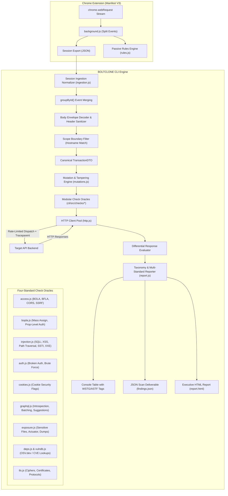

# Design Document: Unified OWASP Testing Engine (Web Top 10, API Top 10, WSTG & ASTF)

* **Author:** kiyaTolcha
* **Date:** 2026-11-03
* **Status:** In Review

---

## 1. Overview & Problem Statement

### 1.1 The Problem
Security engineers, developers, and QA teams evaluating modern web applications and API architectures must navigate four foundational, intersecting security standards:
1. **OWASP Top 10 Web Application Security Risks (2021)**: High-altitude web application risk categories.
2. **OWASP API Security Top 10 (2023)**: Dedicated API business logic, object-level access, and resource consumption risks.
3. **OWASP Web Security Testing Guide (WSTG v4.2)**: Comprehensive, procedural testing methodologies for web applications (Information Gathering, Configuration, Identity, Authentication, Authorization, Session Management, Input Validation, Error Handling, Cryptography, Business Logic, and Client-Side testing).
4. **OWASP API Security Testing Framework (ASTF)**: Systematic methodology specifically targeting API reconnaissance, authentication mechanics, property-level validation, rate limiting, and shadow/zombie API identification.

Currently, tooling across these four standards is highly fragmented:
* **Authentication and State Blindness**: Traditional crawlers and fuzzers test unauthenticated public routes, failing to reach authenticated workflows where WSTG authorization (WSTG-ATHZ) and ASTF object-level tests (ASTF-ATHZ / BOLA) reside. BOLTCLONE's Chrome extension captures authenticated browser sessions, but the CLI previously stripped all headers, cookies, tokens, and payloads, preventing authenticated procedural testing.
* **Lack of Procedural Test Rigor**: Without alignment to WSTG and ASTF methodologies, vulnerability scans rely on ad-hoc URL checks rather than systematic procedural verification (e.g., comparing baseline vs cross-tenant responses, testing parameter boundaries, auditing cookie security flags, or verifying cryptographic ciphers).
* **Toolchain Sprawl**: Teams are forced to run disparate, heavy tools (Burp Suite Pro, OWASP ZAP, Postman, custom scripts) to satisfy audit compliance across Top 10 and procedural testing guides, preventing seamless automation in CI/CD pipelines.
* **Destructive Testing Risks**: Automated fuzzers that blindly mutate state-altering verbs (`POST`, `PUT`, `DELETE`) risk corrupting live or staging databases, deleting records, or locking test accounts without guardrails.

### 1.2 Overview
This design establishes an end-to-end, zero-dependency testing architecture in BOLTCLONE that directly operationalizes:
- **OWASP Top 10 Web (2021)** (A01–A10)
- **OWASP API Security Top 10 (2023)** (API1–API10)
- **OWASP Web Security Testing Guide (WSTG)** procedural test workflows
- **OWASP API Security Testing Framework (ASTF)** systematic API verification

The unified architecture provides:
1. **Stateful Ingestion & Normalization**: Porting transaction merging (`groupById`) to the CLI to recombine split browser `webRequest` events, decode body envelopes (`raw.text`, `formData`), sanitize transport headers, and enforce strict target host scope.
2. **Dual-Context Authorization Matrix**: Providing `--secondary-auth "Bearer <token>"` to execute comparative cross-tenant tests, systematically satisfying WSTG-ATHZ-02 (IDOR) and ASTF-ATHZ-01 (BOLA) with zero false positives.
3. **Procedural Multi-Standard Check Suite**: Coordinating passive in-browser analysis (`chrome-extension/rules.js`) with active CLI modules (`cli/src/checks/*` and `cli/src/mutations.js`), annotating every finding with its exact OWASP Top 10, WSTG, and ASTF identifiers.
4. **Safe-by-Default Execution**: Restricting automated mutation sweeps to read-only/idempotent methods (`GET`, `HEAD`, `OPTIONS`) by default, requiring explicit opt-in (`--allow-mutating-methods`) for state-altering verbs.
5. **Zero External Runtime Dependencies**: Standard Node.js 20+ runtime only (`node:util`, `node:crypto`, `node:tls`, `node:fs`, native `fetch`).

### 1.3 Goals & Non-Goals

#### Goals
* **G-1 (Four-Standard Security Alignment)**: Implement active and passive detection mechanisms mapped across:
  - OWASP Web Top 10 (2021) Categories A01–A10
  - OWASP API Security Top 10 (2023) Categories API1–API10
  - OWASP WSTG Categories (INFO, CONF, IDNT, ATHN, ATHZ, SESS, INPV, ERRH, CRYP, BUSL, CLNT)
  - OWASP ASTF Workflows (DISC, AUTH, ATHZ, INPT, BUSL, CONF)
* **G-2 (Dual-Context Authorization Engine)**: Support comparative multi-tenant evaluation (`--secondary-auth`) to verify resource isolation across Owner, Foreign User, and Unauthenticated contexts (WSTG-ATHZ-02, ASTF-ATHZ-01).
* **G-3 (Canonical Session Ingestion)**: Ingest heterogeneous Chrome extension export formats, merge split request lifecycle events, and unpack JSON and form payloads into mutable structures.
* **G-4 (Target Scope Boundary Enforcement)**: Enforce strict hostname scope matching on all replayed traffic to prevent cross-origin credential exfiltration.
* **G-5 (Safe-by-Default Replay)**: Restrict automated parameter mutation to idempotent HTTP methods by default; gate write-verb mutations behind `--allow-mutating-methods`.
* **G-6 (Unified Compliance Reporting)**: Generate console summaries, JSON deliverables, and executive HTML reports where each vulnerability is mapped to its corresponding Top 10, WSTG, and ASTF taxonomy tags.
* **G-7 (Synthetic Traffic Classification)**: Inject standard distributed tracing headers (`X-Bolt-Test-Run`, `X-Synthetic-Test: true`) so backend APMs isolate scanner traffic from production metrics.
* **G-8 (Zero Runtime Dependencies)**: Keep the entire CLI scanner built strictly on Node.js built-in modules.

#### Non-Goals
* **NG-1 (Automated Destructive Write Fuzzing by Default)**: No blind deletion or modification of backend state without explicit operator consent.
* **NG-2 (Headless Browser Driver Integration)**: Will not embed Chromium or Puppeteer into the CLI; web browsing traffic capture remains the domain of the Chrome extension.
* **NG-3 (Complex Binary Protocol Fuzzing)**: Arbitrary binary and proprietary protocol fuzzing is out of scope and remains delegated to dedicated DAST platforms via `--openapi` and `--postman` exports.

---

## 2. Technical Plan

### 2.1 Architectural Overview & Data Flow
The upgraded architecture bridges captured browser interactions into an automated multi-standard security scanner.



### 2.2 Four-Standard Procedural Mapping Matrix
The scanner organizes all detection modules across OWASP Web 2021, OWASP API 2023, WSTG v4.2, and ASTF:

| Category / Area | OWASP Web (2021) | OWASP API (2023) | WSTG v4.2 Identifier | ASTF Workflow | Check Implementation |
| :--- | :--- | :--- | :--- | :--- | :--- |
| **Object Authorization** | A01: Broken Access | API1: BOLA | `WSTG-ATHZ-02` | `ASTF-ATHZ-01` | `checks/access.js` & `mutations.js` |
| **Function Authorization** | A01: Broken Access | API5: BFLA | `WSTG-ATHZ-03` | `ASTF-ATHZ-02` | `checks/access.js` (Role swapping) |
| **Property Authorization** | A01: Broken Access | API3: BOPLA | `WSTG-BUSL-07` | `ASTF-ATHZ-03` | `checks/bopla.js` (Mass assignment & PII) |
| **Authentication Testing** | A07: Identification | API2: Broken Auth | `WSTG-ATHN-01..08` | `ASTF-AUTH-01..04` | `checks/auth.js` (Default creds & token validation) |
| **Session Management** | A07: Identification | API2: Broken Auth | `WSTG-SESS-01..09` | `ASTF-AUTH-05` | `checks/cookies.js` (`Secure`, `HttpOnly`, `SameSite`) |
| **Resource Consumption** | A04: Insecure Design | API4: Resource Abuse | `WSTG-BUSL-05` | `ASTF-BUSL-01` | `checks/access.js` (Rate limit) & `checks/graphql.js` |
| **Injection (SQL, XSS, etc)**| A03: Injection | API8: Misconfig | `WSTG-INPV-01..19` | `ASTF-INPT-01..05` | `checks/injection.js` (SQLi, XSS, Traversal, SSTI, XXE) |
| **SSRF** | A10: SSRF | API7: SSRF | `WSTG-INPV-19` | `ASTF-INPT-06` | `checks/access.js` (Metadata/Loopback reflection) |
| **Security Misconfiguration**| A05: Misconfiguration | API8: Misconfig | `WSTG-CONF-01..11` | `ASTF-CONF-01..03` | `checks/access.js` (CORS, HSTS, CSP, Host Header) |
| **Cryptographic Failures** | A02: Crypto Failures | API8: Misconfig | `WSTG-CRYP-01..04` | `ASTF-CONF-04` | `checks/tls.js` (Certs, protocols, weak ciphers) |
| **Vulnerable Dependencies** | A06: Outdated Comps | API8: Misconfig | `WSTG-CONF-05` | `ASTF-CONF-05` | `checks/deps.js` & `vulndb.js` (OSV.dev query) |
| **Information Disclosure** | A05: Misconfiguration | API8: Misconfig | `WSTG-INFO-01..10` | `ASTF-DISC-01..04` | `checks/exposure.js` & `discovery.js` |
| **Inventory / Stale APIs** | A05: Misconfiguration | API9: Inventory Mgmt | `WSTG-CONF-06` | `ASTF-DISC-05` | `checks/access.js` (Legacy API routes) & `openapi.js` |

### 2.3 Subsystem Breakdown & Module Design

#### 1. Ingestion & Event Normalizer (`cli/src/ingestion.js`)
* **Event Merging**: Recombines split `chrome.webRequest` events (`onBeforeRequest`, `onSendHeaders`, `onHeadersReceived`) sharing a common `id` into unified `TransactionDTO` records.
* **Header Sanitization**: Converts array-based headers (`[ { name, value } ]`) into a lower-cased dictionary. Strips browser transport pseudo-headers (`sec-ch-ua*`, `host`, `content-length`, `connection`, `upgrade-insecure-requests`).
* **Body Envelope Unpacking**: Automatically extracts payload data from Chrome extension wrappers:
  - Form data: `{ formData: { key: ["val"] } }` -> Normalized key-value map.
  - Raw JSON: `{ raw: [ { text: "..." } ] }` -> Decoded JSON object with syntax validation.
* **Scope Boundary Enforcement**: Filters all transactions to ensure `new URL(tx.url).hostname === new URL(baseUrl).hostname`. Drops off-target requests to prevent credential exfiltration.

#### 2. Mutation & Tampering Engine (`cli/src/mutations.js`)
* **Decoupled Architecture**: Isolated from transport (`http.js`) and assertions (`access.js`), functioning as an asynchronous generator yielding candidate requests:
  - `generateIdorMutations(tx)`: Detects numeric IDs, UUIDs, and slug paths, generating adjacent ID probes.
  - `generateBflaMutations(tx, secondaryToken)`: Tests role boundary escalation by swapping User A auth tokens with User B tokens, or stripping authorization entirely.
  - `generateParamMutations(tx, payloads)`: Injects fuzz vectors across query parameters and JSON body keys without corrupting overall JSON syntax.
  - `generateBoplaMutations(tx)`: Injects administrative properties (e.g. `{"isAdmin": true}`, `{"role": "admin"}`) into JSON request bodies to detect mass assignment vulnerabilities (WSTG-BUSL-07 / ASTF-ATHZ-03).
* **Safety Invariant**: Strictly filters candidate generation by HTTP method: `GET`, `HEAD`, and `OPTIONS` execute in safe mode. Non-idempotent methods (`POST`, `PUT`, `PATCH`, `DELETE`) are skipped unless `--allow-mutating-methods` is enabled.

#### 3. Dual-Context Authorization Oracle (`cli/src/checks/access.js`)
* **Differential Access Matrix**:
  1. **Baseline Request**: Executes request with Owner credentials (`User A`). Expected: HTTP 200 with resource body.
  2. **Tampered Unauth Request**: Executes tampered request with no credentials. Expected: HTTP 401 or 403.
  3. **Tampered Cross-Tenant Request**: Executes tampered request with `--secondary-auth` (`User B`). Expected: HTTP 403 or 404.
* **Finding Classification**: If the cross-tenant probe returns HTTP 200 with identical schema/data structure to the baseline, flags confirmed **BOLA (OWASP API1 / WSTG-ATHZ-02 / ASTF-ATHZ-01)** with high confidence.

#### 4. Transport & Synthetic Telemetry (`cli/src/http.js`)
* **Token-Bucket Rate Limiter**: Configurable dispatch ceiling (default: 15 QPS, max sockets: 8) to protect target infrastructure and avoid WAF bans.
* **Synthetic Traffic Tagging**: Every outgoing test probe carries headers:
  - `X-Bolt-Test-Run: <UUID>`
  - `X-Synthetic-Test: true`
  - `X-Bolt-Standard: <WSTG|ASTF|OWASP-API|OWASP-WEB>`
  - `User-Agent: BOLTCLONE-SecurityScanner/<version>`
* **Transparent Decompression**: Decompresses `gzip` and `brotli` streams via Node `zlib` before passing response bodies to assertion oracles.

#### 5. Multi-Standard Compliance Reporting (`cli/src/report.js` & `htmlReport.js`)
* **Finding Data Structure**:
  ```typescript
  interface FindingDTO {
    category: string;
    title: string;
    severity: 'critical' | 'high' | 'medium' | 'low' | 'info';
    url: string;
    evidence: string;
    standards: {
      owaspWeb: string;   // e.g. "A01:2021-Broken Access Control"
      owaspApi: string;   // e.g. "API1:2023-BOLA"
      wstg: string[];     // e.g. ["WSTG-ATHZ-02"]
      astf: string[];     // e.g. ["ASTF-ATHZ-01"]
    };
  }
  ```
* **Output Deliverables**: Console table grouped by standard, structured JSON export (`--json`), CSV export (`--csv`), and standalone interactive HTML report (`--html`) featuring severity filters and compliance checklists.

---

## 3. Alternatives Considered

* **Monolithic Check Overload (Embedding Mutation in `access.js` & `http.js`)**:
  * *Description*: Directly adding JSON body parsing, path AST traversal, and parameter mutation loops into existing `cli/src/checks/access.js` and `cli/src/http.js` modules.
  * *Rejected by author*: Violates the Single Responsibility Principle. Entangling network transport with testing state machines creates high technical debt, breaks existing clean `(url, timeout, [opts])` function signatures, and makes tuning detection heuristics hazardous.
* **Single-Session ID Incrementation (`ID + 1`) for BOLA**:
  * *Description*: Retaining the legacy approach of testing IDOR by naively incrementing numeric path segments under a single user token.
  * *Rejected by author*: Methodologically invalid for OWASP API1 / WSTG-ATHZ-02. Cannot differentiate between public endpoints, data owned by the same user, and actual unauthorized cross-tenant leaks. Results in high false-positive noise and fails completely on non-numeric UUID identifiers.
* **External DAST / Fuzzing Dependencies (Axios, Lodash, Schemathesis)**:
  * *Description*: Importing third-party npm packages to handle HTTP requests, deep cloning, and OpenAPI fuzzing.
  * *Rejected by author*: Violates BOLTCLONE's core architectural principle of zero external runtime dependencies. Node.js 20+ standard library (`fetch`, `crypto`, `util`, `tls`, `fs`) provides all required primitives with lower supply-chain attack surface and instant startup latency.
* **Confining Active Testing Strictly to Browser UI (Manipulator Wizard)**:
  * *Description*: Relying exclusively on the Chrome extension's interactive DevTools panel for all active mutation and IDOR tests.
  * *Rejected by author*: Prevents headless automation, scheduled security testing, and integration into CI/CD regression pipelines.
* **Bundling Chromium / Puppeteer in the CLI Scanner**:
  * *Description*: Embedding headless browser drivers in the CLI to crawl authenticated Single-Page Applications (SPAs) directly.
  * *Rejected by author*: Adds over 300MB of binary dependencies, creates platform-specific installation friction, and duplicates the Chrome extension's native role as the browser traffic collector.

---

## 4. Detailed Implementation Plan

The implementation is partitioned into four incremental, independently verifiable phases. Each phase maintains a buildable and testable codebase state.

```
Phase 1: Ingestion Normalizer & Transport Hardening
    │
    ▼
Phase 2: Mutation Engine & Dual-Context Authorization Oracle
    │
    ▼
Phase 3: BOPLA Mass Assignment & Multi-Standard Check Expansion
    │
    ▼
Phase 4: Multi-Standard Taxonomy Reporting & Test Harness
```

### 4.1 Target File Boundary & Scope

| Action | Repository-Relative Path | Rationale |
| :--- | :--- | :--- |
| **Create** | `cli/src/ingestion.js` | Merges split `chrome.webRequest` events, decodes body envelopes, sanitizes transport headers, and enforces target host boundaries. |
| **Create** | `cli/src/mutations.js` | Implements asynchronous generator pipeline for IDOR, BFLA, BOPLA, and parameter fuzzing mutations. |
| **Create** | `cli/src/checks/bopla.js` | Evaluates property-level authorization and mass assignment vulnerabilities (API3 / WSTG-BUSL-07 / ASTF-ATHZ-03). |
| **Modify** | `cli/src/args.js` | Adds `--secondary-auth`, `--allow-mutating-methods`, `--dry-run`, and `--rate-limit` CLI arguments with help documentation. |
| **Modify** | `cli/src/http.js` | Implements token-bucket rate limiting (default 15 QPS), synthetic telemetry headers (`X-Bolt-Test-Run`), and native stream decompression. |
| **Modify** | `cli/src/checks/access.js` | Integrates dual-context BOLA verification with `--secondary-auth`, adds BFLA role tampering check, and supports polymorphic transaction descriptors. |
| **Modify** | `cli/src/scan.js` | Connects `ingestion.js`, runs pre-flight connectivity/auth validation, orchestrates mutation testing, and attaches 4-standard taxonomy tags to findings. |
| **Modify** | `cli/src/report.js` | Updates console, JSON, and CSV reports to display and filter findings by OWASP Web 2021, OWASP API 2023, WSTG, and ASTF identifiers. |
| **Modify** | `cli/src/htmlReport.js` | Enhances executive HTML report with dedicated OWASP Top 10, WSTG, and ASTF compliance filter cards. |
| **Create** | `cli/test/test-owasp-engine.js` | Automated verification test suite covering session ingestion, dual-context BOLA detection, BOPLA checks, rate limiting, and scope filtering. |
| **Modify** | `cli/README.md` | Documents new flags, multi-standard testing workflows, and dual-context usage examples. |
| **Modify** | `cli/src/README.md` | Updates package contract to reflect `ingestion.js`, `mutations.js`, and `bopla.js`. |
| **Modify** | `cli/src/checks/README.md` | Updates check subsystem contract to document `bopla.js` and dual-context signatures. |

---

### 4.2 Phase 1: Ingestion Normalizer & Transport Hardening

#### Step 1.1: Create Session Ingestion Normalizer (`cli/src/ingestion.js`)
* **Functions to Implement**:
  - `groupById(logEntries)`: Ingests an array of raw Chrome webRequest event logs. Groups entries by `entry.id`, merging properties across `onBeforeRequest` (URL, method, requestBody), `onSendHeaders` (requestHeaders), and `onHeadersReceived` (statusCode, responseHeaders).
  - `decodeRequestBody(requestBody, contentType)`: Unpacks `{ raw: [{ text }] }` stringified JSON into JavaScript objects; decodes `{ formData: { key: [val] } }` into standard maps; returns string for unrecognized types.
  - `sanitizeHeaders(headersArray)`: Converts `[{ name, value }]` to a lower-cased `Record<string, string>`. Drops `host`, `content-length`, `connection`, `transfer-encoding`, `upgrade-insecure-requests`, and `sec-ch-ua*`.
  - `normalizeSession(rawSessionData, targetBaseUrl)`: Sniffs root envelope (`boltcloneTraffic`, `analysis`, or raw Array). Runs `groupById`, filters transactions by `new URL(tx.url).hostname === new URL(targetBaseUrl).hostname`, decodes bodies, sanitizes headers, and returns canonical `TransactionDTO[]`.
* **Zero-Decision Enforcement**: If an imported file contains only `analysis` objects without headers/body, `normalizeSession` extracts only URLs and returns transactions with `isEnriched: false`.

#### Step 1.2: Harden HTTP Transport & Rate Limiting (`cli/src/http.js`)
* **Functions to Implement / Modify**:
  - `createRateLimiter(rps = 15)`: Implements a token-bucket algorithm using `setTimeout` ensuring dispatch rates do not exceed `rps` requests per second.
  - Update `timeoutFetch(url, opts, timeoutMs)`:
    - Injects synthetic identification headers on every request:
      - `X-Bolt-Test-Run`: Active session UUID generated via `node:crypto.randomUUID()`.
      - `X-Synthetic-Test: true`
      - `X-Bolt-Standard`: Standard identifier tag passed in `opts`.
      - `User-Agent: BOLTCLONE-SecurityScanner/1.0.0`
    - Supports transparent decompression: if `content-encoding` is `gzip` or `br`, pipes response stream through `zlib.createGunzip()` or `zlib.createBrotliDecompress()`.
* **Verification Checkpoint**: Run `node cli/bin/boltclone.js --help` to confirm valid compilation.

---

### 4.3 Phase 2: Mutation Engine & Dual-Context Authorization Oracle

#### Step 2.1: Create Mutation & Tampering Engine (`cli/src/mutations.js`)
* **Functions to Implement**:
  - `*generateIdorMutations(tx, allowMutating = false)`: Analyzes `tx.url`. If method is not `GET`/`HEAD`/`OPTIONS` and `allowMutating` is false, returns immediately. Detects integer path segments (tests `ID + 1`, `ID - 1`), UUID v4 segments (tests swapped byte / random UUID), and query parameter IDs (`?id=`, `?user_id=`). Yields candidate mutation objects `{ tx, mutatedUrl, mutatedBody, mutatedHeaders, mutationType: 'IDOR' }`.
  - `*generateBflaMutations(tx, secondaryAuthToken, allowMutating = false)`: Yields two mutations per privileged endpoint:
    1. Unauthenticated mutation: strips `Authorization` and cookie headers.
    2. Cross-tenant mutation: replaces `Authorization` with `secondaryAuthToken`.
  - `*generateParamMutations(tx, payloads, allowMutating = false)`: Injects fuzz vectors across query strings and JSON object keys without corrupting overall JSON syntax.

#### Step 2.2: Implement Dual-Context Oracle in `cli/src/checks/access.js`
* **Functions to Modify**:
  - Update `checkIdorBola(target, timeout, options = {})`:
    - Handles polymorphic `target`: string URL or `TransactionDTO`.
    - If `TransactionDTO` has auth headers and `options.secondaryAuth` is set:
      1. Dispatches baseline request with original credentials (asserts HTTP 200).
      2. Dispatches unauthenticated probe with stripped credentials. If 200 returned on non-public endpoint, flags **WSTG-ATHZ-02 / BOLA**.
      3. Dispatches cross-tenant probe with `options.secondaryAuth`. If 200 returned with matching JSON body structure, flags confirmed **BOLA (OWASP API1 / WSTG-ATHZ-02 / ASTF-ATHZ-01)** at `high` severity.
    - If `target` is a plain string URL, falls back to legacy path-increment check.
  - Implement `checkBfla(tx, timeout, secondaryAuth)`: Tests administrative routes (`/admin/`, `/manage/`, `/api/v1/users/delete`) under secondary/unprivileged tokens (WSTG-ATHZ-03 / ASTF-ATHZ-02).
* **Verification Checkpoint**: Unit test `checkIdorBola` and `checkBfla` with mock server instances.

---

### 4.4 Phase 3: BOPLA Mass Assignment & Multi-Standard Check Expansion

#### Step 3.1: Create Property-Level Authorization Check (`cli/src/checks/bopla.js`)
* **Functions to Implement**:
  - `checkExcessiveDataExposure(tx, responseBody)`: Scans response JSON bodies for sensitive PII/secrets (`password_hash`, `ssn`, `private_key`, `secret_token`, `credit_card`). Flags **OWASP API3 / WSTG-INFO-05**.
  - `checkMassAssignment(tx, timeout, allowMutating = false)`: For JSON endpoints accepting payloads, injects administrative property overrides (`{"isAdmin": true}`, `{"role": "admin"}`, `{"verified": true}`). If server responds with HTTP 200/201 and reflects the injected property in the response, flags **OWASP API3 / WSTG-BUSL-07 / ASTF-ATHZ-03** at `high` severity.
  - `runBoplaChecks(tx, timeout, options)`: Aggregates property exposure and mass assignment tests.

#### Step 3.2: Update CLI Flags & Scanner Integration (`cli/src/args.js` & `cli/src/scan.js`)
* **CLI Arguments to Add (`cli/src/args.js`)**:
  - `--secondary-auth <token>`: Auth token for User B to power dual-context BOLA/BFLA verification.
  - `--allow-mutating-methods`: Explicit opt-in enabling parameter fuzzing on `POST`, `PUT`, `DELETE`.
  - `--dry-run`: Prints planned mutated requests without dispatching network packets.
  - `--rate-limit <rps>`: Configures maximum requests per second (default: 15).
* **Orchestrator Wiring (`cli/src/scan.js`)**:
  - Reads session file via `ingestion.normalizeSession()`.
  - Runs pre-flight auth check: sends 1 baseline request with captured credentials. If 401/403 returned, warns user: `"Session token expired or invalid; aborting authenticated tests"`.
  - Dispatches `runScan` pool executing `access.js`, `bopla.js`, `injection.js`, `cookies.js`, `graphql.js`, and `exposure.js`.
  - Attaches standard taxonomy mapping object (`standards: { owaspWeb, owaspApi, wstg, astf }`) to every finding.

---

### 4.5 Phase 4: Multi-Standard Reporting & Test Verification

#### Step 4.1: Multi-Standard Reporting Updates (`cli/src/report.js` & `cli/src/htmlReport.js`)
* **Console Reporter (`report.js`)**: Displays four-standard taxonomy tags next to findings:
  `[HIGH] BOLA Detected - /api/orders/102 (OWASP API1 | WSTG-ATHZ-02 | ASTF-ATHZ-01)`
* **HTML Dashboard (`htmlReport.js`)**: Adds interactive filter buttons allowing users to view findings partitioned by:
  - All Findings
  - OWASP Top 10 Web (2021)
  - OWASP API Security Top 10 (2023)
  - OWASP WSTG v4.2
  - OWASP ASTF Workflows

#### Step 4.2: Automated Test Suite (`cli/test/test-owasp-engine.js`)
* **Test Assertions to Implement**:
  1. `ingestion.js`: Merges 3 split webRequest events with matching `id` into 1 unified transaction.
  2. `ingestion.js`: Decodes `{ raw: [{ text: "{\"id\":1}" }] }` into `{ id: 1 }`.
  3. `ingestion.js`: Drops transactions targeting off-scope hosts (`evil.example.com`).
  4. `mutations.js`: Generates IDOR mutations for integer, UUID, and query param targets.
  5. `mutations.js`: Skips `DELETE` and `PUT` endpoints when `allowMutatingMethods` is false.
  6. `access.js`: Flags confirmed BOLA when secondary auth receives HTTP 200 with matching schema.
  7. `bopla.js`: Detects mass assignment when injected `isAdmin` is accepted by mock server.
  8. `http.js`: Injects `X-Bolt-Test-Run` and `X-Synthetic-Test: true` on dispatched requests.
* **Verification Command**:
  - Run: `node cli/test/test-owasp-engine.js`
